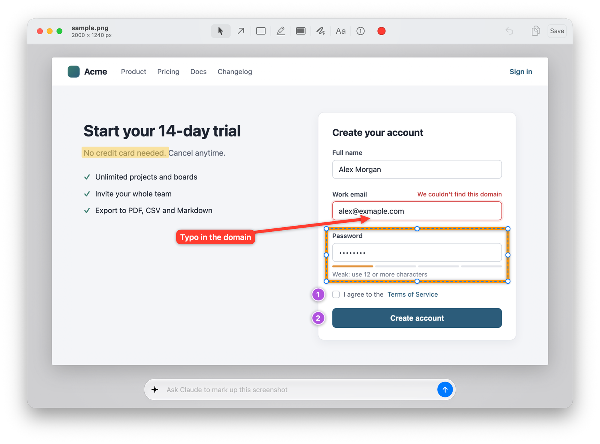

<p align="center"></p>

<h1 align="center">Vocume</h1>

<p align="center">
  Annotate screenshots on your Mac: by hand, or by asking Claude, Codex or a local Ollama model.
</p>

<p align="center">
  <a href="https://github.com/icepuma/vocume/actions/workflows/build.yml"></a>
  <a href="https://github.com/icepuma/vocume/releases/latest"></a>
  
  <a href="LICENSE"></a>
</p>

Vocume lives in the menu bar. Capture an area, a window or the screen and it opens in an editor. Mark it up yourself, or type what you want ("redact every email address", "point out the UI bugs") and an AI does it. Then copy or save the result.

*Named after the Goa'uld vo'cume from Stargate SG-1, a device that records what it sees and plays it back.*

<picture>
  <source media="(prefers-color-scheme: dark)" srcset="assets/screenshot-dark.png">
  
</picture>

## Features

- **Hand tools:** arrows, lines, boxes, ellipses, highlights, solid redaction, pen, text and numbered steps. Shapes resize by their handles; hold Shift for squares, circles and 45° lines.
- **Crop:** by hand with the Crop tool, or ask the AI ("crop to the error dialog"). Cropping never moves your marks and can be changed or undone.
- **Colours:** 8 inks, any custom colour from the system colour panel, or an eyedropper to pick one straight off the screen.
- **AI that hits the right spot:** the model decides *what* to mark; on-device text recognition decides *where*, down to single letters.
- **No API keys:** uses the Claude Code or Codex login you already have, or a model running locally in Ollama.
- **Out of the way:** global capture shortcuts, one editor window per capture, drag the result straight into Slack or a GitHub issue, back to the menu bar when you're done.

## Install

Requires macOS 15 or later. Install the latest release into `/Applications`:

```bash
curl -fsSL https://raw.githubusercontent.com/icepuma/vocume/main/install.sh | bash
```

Or by hand: download `Vocume-x.y.z.dmg` from [Releases](https://github.com/icepuma/vocume/releases/latest), open it and drag **Vocume** onto **Applications**. If macOS says it can't verify the app, open **System Settings → Privacy & Security** and click **Open Anyway** (only needed for builds that aren't notarized).

The first capture asks for the **Screen Recording** permission, which macOS requires for any screenshot tool.

## Usage

Capture with a shortcut or from the menu-bar menu:

| Capture | Default shortcut |
|---|---|
| Area (Space switches to window mode, Esc cancels) | ⌥⇧⌘4 |
| Window | ⌥⇧⌘W |
| Entire screen (the one under the pointer) | ⌥⇧⌘3 |
| Entire screen in 5 seconds | menu only |

Change or clear the shortcuts in **Settings…** (⌘,), where you can also have Vocume open at login. The menu also has **Open Image…** and **Annotate Clipboard Image** for images you already have.

In the editor:

| Action | Keys |
|---|---|
| Select · Arrow · Line · Box · Ellipse · Highlight · Redact · Pen · Text · Step · Crop | V · A · L · R · O · H · X · P · T · N · C |
| Apply the crop | ↩ or Esc (or pick another tool) |
| Undo · Redo · Delete selected mark · Deselect | ⌘Z · ⇧⌘Z · ⌫ · Esc |
| Move the selected mark 1 px · 10 px | Arrow keys · Shift-arrow keys |
| Square / circle / 45° while drawing; keep proportions while resizing | hold Shift |
| Zoom in · out · actual size · fit (or pinch) | ⌘+ · ⌘− · ⌘0 · ⌘9 |
| Ask the AI · Stop it | ⌘↩ · Esc |
| Copy the annotated image · Save it | ⇧⌘C · ⌘S |

Colour and size are under **Ink** in the toolbar. Drag a selected mark to move it, or drag its handles to resize it; click it again to edit its label. To share, drag the hand icon in the toolbar into another app, or copy or save. Closing a window with marks you haven't copied or saved asks first.

## AI annotation

Vocume detects what's on your Mac and offers it in the AI bar:

- **Claude:** the `claude` CLI from [Claude Code](https://claude.com/claude-code), signed in with your subscription.
- **Codex:** the `codex` CLI, signed in with ChatGPT.
- **Ollama:** a local vision model from [ollama.com](https://ollama.com). We test with `gemma4:12b` (`ollama pull gemma4:12b`).

**Settings…** shows what was detected, lets you choose which providers to offer and which Ollama model to use, or turns AI off entirely.

## Privacy

Vocume has no account, no telemetry and no server. Screenshots stay on your Mac unless you ask an AI to annotate one: then the image and the recognized text go to the provider you picked (Anthropic through `claude`, OpenAI through `codex`), or stay on your Mac with Ollama. Text recognition always runs on-device.

> [!WARNING]
> Asking Claude or Codex to redact something sends them the **unredacted** screenshot, so they see exactly what you wanted hidden. For sensitive content, redact by hand or use a local Ollama model.

> [!NOTE]
> Local models are not fully tested yet. Results vary by model; `gemma4:12b` is the one we have tried most.

## Development

Needs only the Xcode Command Line Tools with Swift 6.2 or later (`xcode-select --install`).

```bash
make signing   # once: a stable local signing identity (see below)
make run       # build build/Vocume.app for this Mac and launch it
make check     # lint, build and test, as CI does
```

`make signing` keeps permissions across rebuilds. macOS ties privacy permissions such as Screen Recording to an app's code signature, so it creates a self-signed "Vocume Local Development" identity in its own keychain (`~/Library/Application Support/dev.icepuma.vocume/`, no trust settings changed) and signs every local build with it. Without it, builds are ad-hoc signed and each one looks like a new app. Remove it with `scripts/dev-signing.sh --remove`.

Code layout and conventions are in [AGENTS.md](AGENTS.md).

### Releasing

Push a version tag; GitHub Actions builds the universal DMG and publishes the release:

```bash
git tag vX.Y.Z && git push origin vX.Y.Z
```

For signed and notarized builds (no Gatekeeper warning), add these repository secrets: `MACOS_CERT_P12` (base64 of a Developer ID Application certificate), `MACOS_CERT_PASSWORD`, `APPLE_ID`, `APPLE_TEAM_ID` and `APPLE_APP_PASSWORD`.

## License

[MIT](LICENSE). Copyright © 2026 Stefan Ruzitschka.
